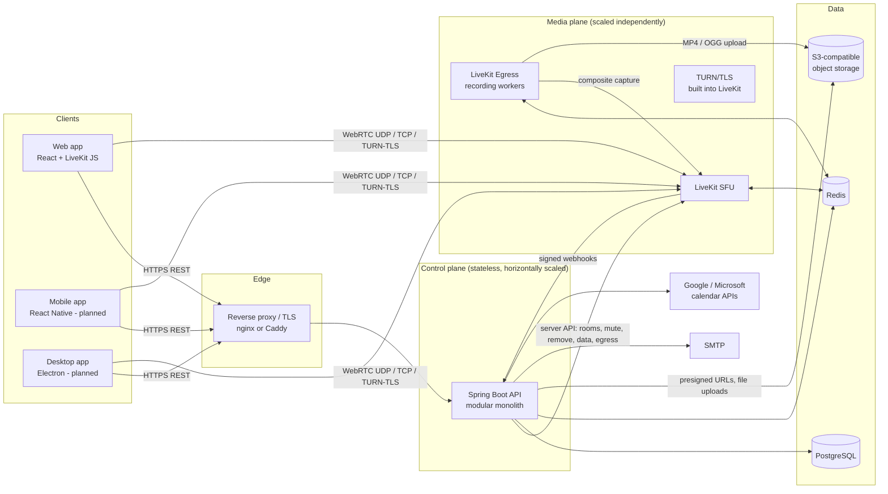
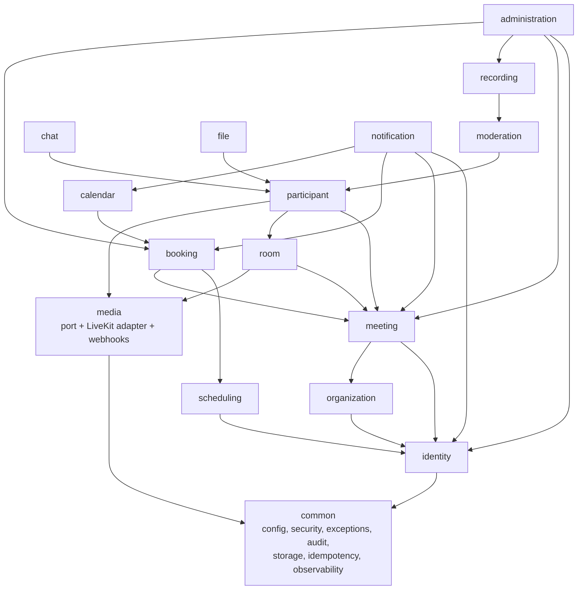
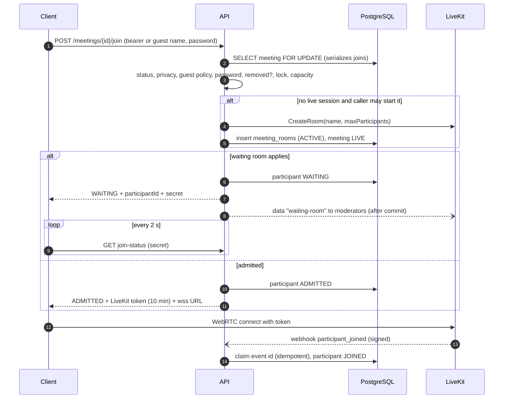
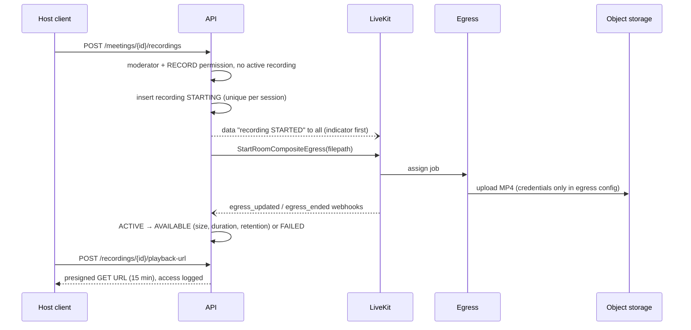

# 02 — Architecture

## System context

Key decisions:

* **Media never touches the API.** Browsers exchange media with the SFU; the API issues ≤ 10-minute join tokens
  and calls the SFU's admin API for moderation.
* **The SFU is the source of truth for live presence.** Durable state (who joined, when, recordings) is updated from
  signature-verified, idempotent webhooks.
* **Modular monolith.** One deployable API with strict module boundaries (below). No Kafka or microservices:
  current load and durability needs are met by PostgreSQL (outbox for e-mail, `SKIP LOCKED` dispatch) and Redis
  (rate limits). The LiveKit SFU and Egress workers are separately deployable and scale independently.

## Backend modules

Dependency-inversion points that keep the graph acyclic:

| Interface | Declared in | Implemented in |
|---|---|---|
| `SessionStatusChecker` | common.security | identity (`SessionService`) |
| `MeetingParticipationLookup` | meeting | participant (`ParticipationLookupService`) |
| `MediaService` | media.service | media.adapter.livekit (`LiveKitMediaAdapter`) |
| `ObjectStorage` | common.storage | `MinioObjectStorage` (any S3 API) |
| `CalendarProvider` | calendar.adapter | Google, Microsoft |

Cross-module reactions use Spring application events (`RoomEvents.SessionEnded`, `MediaWebhookEvent`,
`BookingEvents.*`, `IdentityEvents.*`, `MeetingEvents.*`). Listeners run in the publisher's transaction, so a
side effect (e.g. queued e-mail) is committed only with the change that caused it. External calls that must
not hold a database transaction (calendar sync, SFU room deletion, data messages) run after commit.

## Key flows

### Join and admission

### Cloud recording

### Booking without double booking

1. Slot list = weekly rules in host zone (DST-aware) − exceptions − confirmed bookings (with buffers)
   − host's scheduled meetings − notice/advance window.
2. `POST /bookings` re-validates that the requested start is still an offered slot.
3. The insert is flushed immediately; PostgreSQL's exclusion constraint
   `EXCLUDE USING gist (host_id WITH =, tstzrange(blocked_start, blocked_end) WITH &&) WHERE status='CONFIRMED'`
   lets exactly one of several concurrent transactions commit. The others surface as `409 SLOT_UNAVAILABLE`.

## Scaling model

| Component | State | Scale by |
|---|---|---|
| API | Stateless (JWT + DB + Redis) | Replicas behind the proxy; HikariCP pool bounded (`DB_POOL_SIZE`) per replica |
| LiveKit SFU | Room state in memory, cluster coordination in Redis | Add nodes; LiveKit places rooms; one room is hosted on one node |
| Egress | Stateless workers | Add workers; each composite recording uses ~2–4 vCPU (headless Chrome + encoder) |
| PostgreSQL | Primary | Vertical first; read replicas for reporting if ever needed |
| Redis | Rate-limit counters, LiveKit coordination | Single instance with AOF; Sentinel/managed Redis in production |

## Technology choices and deviations

| Area | Choice | Note |
|---|---|---|
| Backend | Java 21, Spring Boot 4.0.9, Spring Security 7, Hibernate 7, Flyway 11 | Latest stable line at build time |
| Media | LiveKit SFU v1.13, Egress v1.15, `io.livekit:livekit-server` 0.16 SDK | |
| Object storage | S3 API (MinIO in compose) | Upstream MinIO no longer publishes images; compose pins a maintained build |
| Web | React, TypeScript, Vite, Tailwind, shadcn/ui-style components, TanStack Query, RHF + Zod, LiveKit React | |
| Desktop | **Electron** (recommended) | Evaluation: Electron ships Chromium, so `getDisplayMedia`/`desktopCapturer`, WebRTC and MediaRecorder behave the same as in Chrome on all OSes; Tauri uses WebView2/WKWebView/WebKitGTK whose WebRTC/screen-capture support differs per OS (notably WebKitGTK on Linux). Not implemented yet (Phase 6). |
| Mobile | React Native + `@livekit/react-native` | Not implemented yet (Phase 6). |
