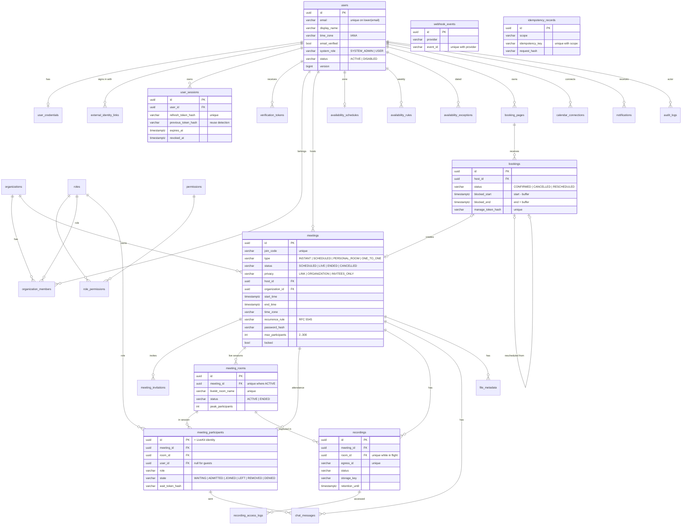

# 03 — Database Design (PostgreSQL)

Schema source of truth: `backend/src/main/resources/db/migration` (Flyway). Hibernate runs with
`ddl-auto=validate`, so the application refuses to start if entities and schema diverge.

Conventions: UUID primary keys assigned by the application; `timestamptz` for every instant (stored in UTC);
IANA zone ids stored next to local dates/times; `version` columns for optimistic locking; secrets (refresh tokens,
verification tokens, manage tokens, participant secrets) stored only as SHA-256 hashes; passwords as bcrypt.

## Integrity and concurrency guarantees enforced by the database

| Guarantee | Mechanism |
|---|---|
| No overlapping confirmed bookings per host (buffers included) | `EXCLUDE USING gist (host_id WITH =, tstzrange(blocked_start, blocked_end,'[)') WITH &&) WHERE status='CONFIRMED'` (needs `btree_gist`) |
| One live session per meeting | partial unique index `meeting_rooms(meeting_id) WHERE status='ACTIVE'` |
| One in-flight cloud recording per session | partial unique index `recordings(room_id) WHERE status IN ('STARTING','ACTIVE','STOPPING')` |
| One personal room per user | partial unique index `meetings(host_id) WHERE type='PERSONAL_ROOM'` |
| Webhooks processed once | unique `(provider, event_id)` + `INSERT … ON CONFLICT DO NOTHING` claim |
| Case-insensitive unique e-mail | unique index on `lower(email)` |
| Enumerations and ranges | `CHECK` constraints on every status/role/type column and numeric limits |
| Capacity / admission races | `SELECT … FOR UPDATE` on the meeting row during join, admit and lifecycle changes |
| E-mail delivered once across instances | `SELECT … FOR UPDATE SKIP LOCKED` claim in the dispatcher |

## Indexing for hot paths

| Query | Index |
|---|---|
| Meetings list for a user | `meetings(host_id, start_time)`, `meeting_invitations(user_id)`, `meeting_participants(user_id, created_at)` |
| Seat counting / presence | `meeting_participants(room_id, state)`, `(meeting_id, state)` |
| Busy time for slot computation | `bookings(host_id, start_time)` + the GiST exclusion index, `meetings(host_id, start_time)` |
| Due e-mails | partial `notifications(scheduled_at) WHERE status='PENDING' AND channel='EMAIL'` |
| Audit search | `audit_logs(resource_type, resource_id, created_at)`, `(actor_user_id, created_at)`, `(action, created_at)` |
| Retention job | partial `recordings(retention_until) WHERE status='AVAILABLE'` |

## Migrations

| Version | Content |
|---|---|
| V1 | Baseline: all tables, constraints, indexes, role/permission reference data |
| V2 | `bookings.external_calendar_provider`, `external_event_id` for calendar sync |
